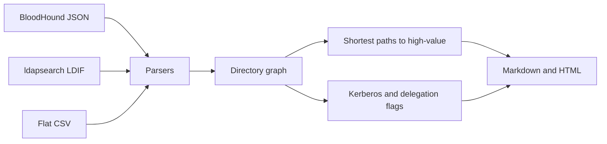

[](https://github.com/WastedPatriot/kerbside/actions/workflows/ci.yml)
[](https://www.python.org/)
[](LICENSE)

# kerbside

kerbside reads the JSON and LDIF you already brought home and tells you, in plain speech, who can reach the important groups and which accounts have their Kerberos coat unbuttoned.

It does not talk to a domain controller. It will not pop a shell. It sits on the kerb with the exports and points.

Built for authorised work: a lab, HTB, CPTS practice, a range, a signed test. If nobody has said yes, this is the wrong tool and also the wrong afternoon. See [AUTHORISED.md](AUTHORISED.md).

## A sample run

Northsea is a fictional borough that ships with the package. Nothing is listening.

```
kerbside scan --dry-run
```

```
╭────────────────────────────────────────────────────────╮
│ kerbside  0.1.0                                        │
│ Stands on the kerb. Reads the bags you already packed. │
╰────────────────────────────────────────────────────────╯
Dry run. The borough of Northsea is fictional. No directory was contacted, which
is the whole idea.

 source       bundled Northsea fixture (dry run)
 domain       northsea.local
 principals   25
 edges        29
 paths        5
 findings     3 high, 1 medium, 1 low, 2 info

╭─────────────────────────────────── Path 1 ───────────────────────────────────╮
│ sync.svc@northsea.local                                                      │
│   DCSync → northsea.local                                                    │
╰───────────────────────────── critical · 1 hops ──────────────────────────────╯
╭─────────────────────────────────── Path 4 ───────────────────────────────────╮
│ bob.haddock@northsea.local                                                   │
│   MemberOf → Helpdesk@northsea.local                                         │
│   GenericAll → svc.files@northsea.local                                      │
│   AdminTo → fs01.northsea.local                                              │
│   HasSession → diana.croft@northsea.local                                    │
╰────────────── critical · 4 hops · also ed.marsh@northsea.local ──────────────╯

                            Kerberos and delegation

  Sev      Account                         What
 ──────────────────────────────────────────────────────────────────────────────
  high     carol.wicks@northsea.local      AS-REP roastable account
  high     web01.northsea.local            Unconstrained delegation
  medium   sql.svc@northsea.local          Kerberoastable account
  info     dc01.northsea.local             Unconstrained delegation on a
                                           domain controller

Particulars, and the fix, are in the report.

wrote kerbside-out/report.md
wrote kerbside-out/report.html
```

The real dry run prints all five paths and every finding. Path 1, path 4, and a few of the flags are above, so this page stays readable. Bob and Ed share a route; the tool says so instead of printing it twice.

## Quick start

```bash
git clone https://github.com/WastedPatriot/kerbside
cd kerbside
python3 -m venv .venv
source .venv/bin/activate
pip install -e .
kerbside scan --dry-run
```

Python 3.11 or newer. The only runtime dependency is [Rich](https://github.com/Textualize/rich).

Your own collection:

```bash
kerbside scan -i ./sharp-out -o ./kerbside-out
```

`sharp-out` is the folder of `users.json`, `groups.json`, `computers.json`, `domains.json` that SharpHound already wrote. Unzip it first. Zips are on the list, not in this version.

## Usage

```
kerbside scan -i ./sharp-out
kerbside scan -i ./ldap.ldif --format ldif
kerbside scan -i ./lampeter --from mira
kerbside scan --dry-run --depth 3
```

| Flag | What it does |
| --- | --- |
| `-i, --input` | A file or a directory |
| `-o, --output` | Where `report.md` and `report.html` go. Default `kerbside-out` |
| `--format` | `auto` (the default), `bloodhound`, `ldif`, or `csv` |
| `--dry-run` | Ignore the real world and read the bundled Northsea fixture |
| `--depth` | Hop limit. Default 6 |
| `--limit` | How many paths to keep. Default 25 |
| `--from NAME` | Only paths that involve a matching principal |

`auto` looks at the suffix, then the contents. A directory with any JSON is treated as BloodHound. LDIF is what `ldapsearch -LLL` emits, folding and all. CSV is the flat shape described further down, for when you have already tamed a PowerView export into columns.

Exit codes: `0` the report was written, including the case where the kerb is empty. `2` you asked for something that is not there, or a depth of zero. `1` the files were found and still produced no principals.

A path is a chain of rights and memberships already in the export. The report names each hop and says, in one line, what that right means. It does not hand you a command to type next.

High value, for the purpose of stopping, means Domain Admins, Enterprise Admins, Schema Admins, Administrators, the usual operator groups (Backup, Account, Server, Print, DNSAdmins, Key Admins), the domain object itself, and domain controllers. A group that has been renamed still counts if the SID is the well-known one. `Domänen-Admins` with RID 512 is still Domain Admins. kerbside is not fooled by a coat of paint.

## A corner of the report

`report.md` and `report.html` carry the same facts. The HTML is one file, with the styling in it, so you can hand it to someone without a build step. From the Northsea dry run:

```markdown
### 4. bob.haddock@northsea.local → diana.croft@northsea.local

- **Severity:** critical
- **Hops:** 4
- **Why the target matters:** Domain Admins@northsea.local
- **Same route for:** ed.marsh@northsea.local

1. `bob.haddock@northsea.local`
2. **MemberOf** → `Helpdesk@northsea.local`
3. **GenericAll** → `svc.files@northsea.local`
4. **AdminTo** → `fs01.northsea.local`
5. **HasSession** → `diana.croft@northsea.local`
```

```markdown
### high — AS-REP roastable account

**carol.wicks@northsea.local**

Kerberos will issue an AS-REP for this account without proving the caller
knows the password first. Offline guessing gets a lot cheaper.

*Fix:* Turn pre-authentication back on. If a legacy application genuinely
cannot cope, that application is the finding.
```

If nothing reaches a high-value principal, the report does not invent one. It says the kerb is empty and suggests the kettle.

Flags it will bother you about:

- AS-REP roastable accounts (pre-authentication off), including the disabled ones that will bite the next person who ticks "enabled"
- Kerberoastable users, meaning a user with an SPN. Computers and `krbtgt` are not listed for the sake of it
- Unconstrained delegation. On a domain controller this is noted as expected. On a member server it is not
- Constrained delegation, and protocol transition when `TrustedToAuthForDelegation` is set
- `PASSWD_NOTREQD`
- Descriptions that mention a password or a secret
- `adminCount` left on an account that is no longer high value

## How it works



Parsers turn the three formats into the same objects and edges. Privileged group membership is closed over, so a path stops when it reaches someone who is already in Domain Admins rather than wandering off through them. Routes that only differ by the person at the start are collapsed into one, with the others named.

Computers are not treated as attackers merely because a session was collected there. The interesting fact is who can administer that computer.

## Roadmap

- SharpHound `.zip` without the unzip dance
- GPO and OU edges, once the right is actually on the GPO and not just "this OU exists"
- A diff between two collections, for the day after someone swears they fixed it
- A `--owned` list, so the paths start from the principals you already hold rather than from everyone

Not planned: talking to a KDC. Plenty of tools already do that, and they are not this one.

## Development

```bash
pip install -e ".[dev]"
ruff check .
pytest
```

CI runs both on 3.11 and 3.12. The tests use the fixtures. They do not need a lab.

## Licence

[MIT](LICENSE). Copyright 2026 WastedPatriot.

<details>
<summary>Why kerbside?</summary>

BloodHound already took the good animal. This one waits at the side of the road and goes through the bags you carried back. The yellow line on the report is a kerb, not a brand exercise.
</details>

<details>
<summary>What it will not do</summary>

It will not authenticate, spray, relay, request tickets, or dump hashes. There is no button for the naughty bit. If the report says an account is Kerberoastable, it means the SPN is there and you should fix that. It does not mean kerbside is about to ask for the ticket.
</details>

<details>
<summary>Who is who in Northsea</summary>

All of them are made up.

- **diana.croft** is in Domain Admins. She has a session on FS01.
- **bob.haddock** and **ed.marsh** are Helpdesk. Helpdesk has GenericAll on `svc.files`, and that account is a local admin on FS01.
- **print.svc** is trusted to delegate to FS01, with protocol transition.
- **sync.svc** has replication rights on the domain.
- **nora.quay** can reset `svc.backup`, who sits in Backup Operators.
- **carol.wicks** has pre-authentication turned off, and no path to anywhere interesting. Both things can be true.
- **sql.svc** has an MSSQL SPN and a description that should have stayed on the sticky note, which should not have existed either.
- **web01** is a member server with unconstrained delegation. **dc01** has it too, and is a domain controller, so the report does not pretend to be shocked.
- **alice.pence** is fine. Someone has to be.
</details>

<details>
<summary>CSV columns</summary>

Two files, told apart by the header.

Objects: `object_id,type,name,sam,domain,enabled,high_value,is_dc,member_of,spns,dont_req_preauth,unconstrained,trusted_to_auth,delegate_to,password_not_required,description`

Edges: `source,relation,target,inherited`

`member_of`, `spns`, and `delegate_to` are pipe-separated when a cell holds more than one. `type` is `user`, `group`, `computer`, or `domain`. Booleans are `true` or `false`. There is a tiny example under `src/kerbside/data/fixtures/lampeter`.
</details>

<details>
<summary>kerbside roast</summary>

`kerbside roast` is a joke. It has a short go at the habits that show up in every lab, and then it recommends a potato. It does not connect to anything. If you came here for hashes, the potato is the disappointment.
</details>
